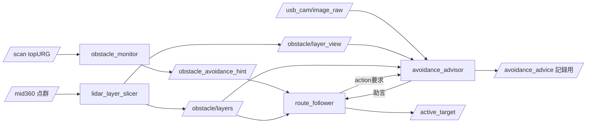

# AI助言による障害物回避

## 1. 目的と対象範囲

本書は、停止した障害物の前で「どちらへ、どれだけ避けるか」をAIエージェントへ問い合わせ、
その助言を既存の回避へ入力する構成の、責務分担と安全境界を定める。

対象は `avoidance_advisor`、`lidar_layer_slicer`、`route_follower`、`obstacle_monitor`、
`icart_bringup` である。各パッケージの内部実装は詳細設計書を正とし、本書では扱わない。

次は対象に含めない。

- 横断歩道上で停止せずに回避する特例。経路データに区間属性が無く、走行しながらの回避は
  現在の回避起動条件と両立しないため、別に扱う。
- 前方のロボットへの追従制御。回避を発動しなければ `robot_navigator` が前方余裕距離に
  応じて減速・停止し、前車が動けば追い付く。専用の制御を作らない（5章）。
- 障害物の種類を判定して停止条件を変えること。停止判定は従来どおり `obstacle_monitor` が
  行う（4章）。

AIを使う構成は、推論を機上PCの外部CLI（`claude -p` 相当）で実行することを前提とする。
推論自体はネットワークの先にあり、応答時間も可用性も走行系の制御周期とは別の時間軸に
ある。**現状は、実機の自律走行ではこの機能を無効のまま走る**（6.5節）。

## 2. 全体構成

AI助言は既存の回避へ差し込む追加経路であり、置き換えではない。助言を使わない構成が
常に成立していることを前提に設計する。

| パッケージ | 役割 | AI助言を使わない構成での扱い |
| --- | --- | --- |
| `obstacle_monitor` | topURGの`/scan`から前方閉塞と左右オフセットのヒントを出す | 変更なし。常に動く |
| `lidar_layer_slicer` | MID-360の点群を水平スライスし、層ごとの観測値と可視化画像を出す | 起動しなくてよい。回避幅は採取幅と大域上限で決まる |
| `avoidance_advisor` | 停止中に外部CLIへ助言を求め、検証とクランプを行う | 起動しなくてよい。要求は退避する |
| `route_follower` | 滞留検知、助言の要求と採用、回避目標の生成、待機 | `use_ai_advice=false` で従来の左右選択だけで動く |
| `icart_bringup` | 共通起動。実機では助言を無効にし、走行を記録する | 既定の構成 |

`lidar_layer_slicer` と `avoidance_advisor` は共通起動に含める。ただし**助言が有効な場合に
だけ起動する**。実機では助言を無効にしているため、現状これらは実機で動かない（6.5節）。

助言なしの走行でこれらを起動しない理由は、層の観測値が回避幅の上限に効くためである。
起動すると、比較の基準にしたい「従来どおりの走行」が従来の挙動でなくなる。層は記録した
bagから再現できる（7章）。

助言の遅延・欠落・異常は4.4節の退避で吸収する。要求は非同期で、待機の上限を過ぎれば
goalを取り消して従来の回避へ移るため、走行経路の応答時間は助言の有無に依存しない。

**助言ノードの終了は走行を止めない。** 共通起動は「主要子プロセスが終了したら全体を停止
する」規則を持ち、launchのNodeもこの規則の対象になる。助言と層スライスはこの登録より後へ
追加して対象から外している。助言は走行の付帯機能であり、停止の理由にしない。

## 3. データフロー

要求から採用までの順序を示す。

1. `route_follower` が停止と前方閉塞の継続を検出し、action で助言を要求する。
   要求には採用可能なオフセットの範囲（採取幅・実測空き幅・大域上限の最小値）を入れる。
2. `avoidance_advisor` が購読済みの層画像・カメラ画像・層観測値から要求文を作り、
   外部CLIを起動する。入力画像と要求文、CLIの出力は要求ごとに保存する。
3. 応答のJSONを検証し、範囲へ収めた助言を result で返す。採用できない場合は理由を返す。
4. `route_follower` が助言を実効上限で再度クランプして回避サブゴールを作るか、待機へ入る。

## 4. 境界の定義

パッケージ間の約束を次に定める。破られたときの下流の挙動も併せて示す。

### 4.1 停止判定とスライスの分離

**前方閉塞（停止の契機）は `obstacle_monitor` が `/scan` のみから判定する。**
水平スライスは停止判定に使わない。層を停止判定へ入れると、路肩から張り出した草や
植え込みのように、従来は止まらなかった対象で停止するようになる。スライスの用途は
回避幅の上限と、AIへ渡す状況説明の2つに限る。

### 4.2 観測値の意味

層の点数0は**未観測**であり、障害物が無いことを意味しない。TF未取得、入力途絶、
その高さが観測範囲外のいずれでも0になる。これらを区別する値は持たない。
したがって、点数0の層は使用可能幅の算出から外す。空いているとみなすと観測できていない
高さの障害物へ向かって幅を広げ、塞がっているとみなすと観測距離に達していない層のせいで
回避できなくなる。

**現在の実装は反射点だけで空きを決めており、光線が通過したかどうかを使っていない。**
ある横移動量に反射点が無ければ空きとして扱うため、障害物の背後（光線が届かない影）も
空きになる。一方で層全体の点数が0の場合は層ごと判定から外す。同じ「点が無い」状態を、
層の内側では空き、層の単位では未観測と扱う非対称がある。

占有格子地図で一般的な、光線が通過した領域を空き、その先と影を未観測とする区別は
実装していない。層の点数0を未観測として扱うのは、この区別が無いことへの保守的な
代替である。改善の選択肢は7章に挙げる。

実測空き幅には鮮度がある。受信から既定2秒を過ぎた値は上限に使わない。

### 4.3 助言は提案値である

`AvoidanceAdvice` は提案であり、指令ではない。採用側（`route_follower`）が次を保証する。

- 採用オフセットは `clamp(助言, 最小オフセット, min(採取幅, 実測空き幅, 大域上限))` に収める。
  要求時にも上限を渡すが、実測空き幅は採用側しか持たないため、採用時に必ず再検査する。
- 上限が最小オフセットに満たない側の助言は採用しない。その幅では回避が成立しない。
- 助言は目標点を作らない。目標の生成は `route_follower` だけが行う。

### 4.4 退避の階層

次のいずれでも**従来の回避へ退避する**。退避は異常ではなく通常の経路である。

| 条件 | 退避先 |
| --- | --- |
| 機能が無効（既定）、呼び出し抑制に掛かった | 従来の左右選択 |
| action server 未起動、goal 拒否 | 従来の左右選択 |
| 待機上限内に助言が返らない（goalを取り消す） | 従来の左右選択 |
| 出力が空・JSONなし・スキーマ違反・確信度不足 | 従来の左右選択 |
| CLIのタイムアウト・異常終了 | 従来の左右選択 |
| 助言された側に余裕が無い | 従来の左右選択 |
| 待機の上限を過ぎても前方が解消しない | 従来の回避を1回試み、不可なら再経路要求 |

## 5. 各パッケージの責務

**`obstacle_monitor`** は前方閉塞と左右オフセットのヒントを出す。障害物の種類を判定せず、
MID-360を使わず、助言の有無で挙動を変えない。

**`lidar_layer_slicer`** は層の観測値と可視化画像を出す。停止判定をせず、回避方向を決めず、
障害物の種類を推定しない。層の高さは取付角に依存するため、取付を変えたら選び直す（6.2節）。

**`avoidance_advisor`** は要求文の組み立て、CLIの実行と打ち切り、応答の検証とクランプを行う。
いつ要求するかを決めず、呼び出し回数を管理せず、目標を作らない。同時実行を1件に制限する
だけで、予算とクールダウンは要求側が持つ。

**`route_follower`** は要求の発火条件、呼び出しの抑制、助言の採用、待機、回避目標の生成を行う。
AIの応答内容の妥当性は検査しない（形式と値域は advisor が検査済みである）。

**`icart_bringup`** は構成の選択を行う。実機では助言を無効にして起動し、走行を記録する。
助言ノードとスライスノードを共通起動に含めない。

## 6. 設計上の制約と前提

### 6.1 障害物の種類別の方針

走行中に停止へ至る代表例は、運営が設置した緑のロードコーン、車止めのようなポール、
同じ方向に走行しているロボット、反対方向に走行しているロボット、草、人である。
現行の回避は左右のオフセットが小さい側を選ぶだけで、種類も静止・移動の別も判断に入らない。
AIへ問うのはこの区別であり、方針は次のとおりである。

| 障害物 | 方針 | 実現方法 |
| --- | --- | --- |
| コーン、ポール、草 | 静止物として回避し、すぐ走行を再開する | 助言の「回避」。方向と量を採用 |
| 人 | 待機して通過を待つ | 助言の「待機」。前方が空けば即復帰 |
| 同じ方向へ進むロボット | 追い越さず、付いていく | 助言の「待機」。回避を発動しないことで追従が成立する |
| 対向するロボット | 待機し、解消しなければ回避 | 助言の「待機」＋待機上限後の従来回避 |

草については、本来通行できる場所でLiDARに写り込む場合がある。これを「避けずに進む」
行動として扱うことは要件から外した。障害物検知を意図的に無視する経路を作らないためである。
草も静止物として回避する。

### 6.2 層の高さは取付角に依存する

MID-360は床上0.562 m、前下がり26.9°で取り付ける（`icart_bringup/params/hardware.yaml`）。
仰角-7°〜+52°が回転して車体基準で-33.9°〜+25.1°になり、距離dで観測できる床上高さは
`0.562 - 0.672d` 〜 `0.562 + 0.468d` [m] である。既定の層（床上0.35 mと0.50 m）は
それぞれ0.32 m、0.09 m以遠から観測できる。

**水平取付では床上0.35 mの層が1.7 m以遠まで観測できず、この構成は成立しない。**
停止判定が起きる0.75〜1.5 mで層に点が入らないためである。取付角を変える場合は、
層の高さを選び直す必要がある。

人の胴体（床上1.1〜1.2 m）は1.4 m以遠でしか観測できない。近傍での人とロボットの識別は
カメラ画像の役割とする。

### 6.3 外部CLIの時間軸

推論はプロセス起動とネットワーク往復を含み、応答に数秒から十数秒かかる。制御周期（50 ms）
とは別の時間軸であり、次の制約が生じる。

- 問い合わせは停止中に限る。滞留検知（15秒）を待ってから問い合わせると1つの障害物で
  25〜30秒停止するため、**発火だけを前倒しする**。滞留検知のしきい値は変更しない。
- 低速の先行車へ追い付いて止まる動作を繰り返すと呼び出しが嵩む。停止の継続時間、
  時間と距離のクールダウン、分あたりと走行全体の予算で、呼び出し回数に上界を与える。
- 機上PCでは FAST-LIO や YOLO と計算資源を共有するため、同時実行は1件に限る。
- 打ち切りはプロセスグループ単位で行う。CLI本体だけを終了させると、推論を続ける子プロセスが
  機上PCに残る。

### 6.4 作業ディレクトリの隔離

CLIはリポジトリ外の作業ディレクトリで起動する。リポジトリ内で起動すると、リポジトリの
設定ファイルや指示をエージェントが読み込み、回避の判断と無関係な指示が助言へ混入する。

### 6.5 実機では無効にする

実機の共通起動は助言を無効にして起動し、引数で有効にしても無視する。**助言なしで障害物
回避が作動する記録を残し、後からbag再生で助言の有無を比較するため**である。この比較が
済むまで、実機で助言を使った走行は行わない。

比較の材料として、実機の自律走行ではrosbagを自動記録する。記録の失敗で走行は止めない。

助言を有効にすれば、共通起動が層スライスと助言のノードも起動する（2章）。導入時に
起動手順は変わらない。助言が間に合わない場合に走行が待たされないことは、4.4節の退避が
担保する。

### 6.6 AIの応答は検査できる範囲が限られる

検査しているのは形式（JSONであること、行動種別が定義済みであること）と値域だけである。
**助言の内容が正しいかどうかを検査する手段はない。** 確信度もエージェントの自己申告であり、
較正されていない。したがって、助言を採用しても安全の根拠は従来どおり幅のクランプと
停止判定にあり、助言はその範囲内での選択にすぎない。

## 7. 未解決事項

助言を実機で使い始めるまでの道筋を次に定める。**6.5節の無効化を解除してよいのは、
2と3を確認できた後である。**

1. 次の実走行で、助言を使わない自律走行のログ（rosbag）を取得する。
   共通起動が自動で記録するため、操作者の開始操作には依存しない。
2. 取得したログの停止・回避の場面で、実際のAIエージェントへ問い合わせ、助言の妥当性を
   確認する。障害物の種類の判別、方向と量の妥当性、応答時間、応答形式の安定性を見る。
   未確認なのはこの4点であり、現在の確認は代替スクリプトによる形式面に留まる。
3. 同じ場面について、助言を使った場合と使わない場合の回避を比較し、効果を確認する。
   比較する値は、選んだ方向、採用したオフセット、回避の成否、停止していた時間とする。
4. 2と3で有効性を確認できた段階で、実機走行へ導入する。

同じログから、次の設計値も見直す。いずれも実走の計測値ではない。

- 呼び出しの抑制条件（停止継続3秒、クールダウン20秒／3 m、予算4回/分・30回）と、
  その結果の呼び出し頻度・採用率。
- 助言を採用する確信度の下限0.5。
- 待機の既定10秒と上限30秒。
- 層の高さ0.35 m／0.50 mと厚さ0.10 m。記録済みbagでは両層に点が乗ることまでを確認した。

層の空きと未観測を区別する方法も未解決である。現在は反射点だけで空きを決めており、
影を空きとして扱う（4.2節）。光線の通過を使えば、占有格子地図と同じく空き・占有・未観測を
分けられる。2D scanは各ビームの方位と距離から通過領域を直接求められる。MID-360は
走査が疎で、ビームが無い方位は未観測として残るため、未観測の割合そのものを出力へ
加えるかどうかも併せて決める必要がある。

模擬環境での比較シナリオ（コーン、人、同方向および対向のロボット）は未着手である。
模擬ロボットの取付は実機値へ更新済みで、シナリオを用意すれば着手できる。実走行のログが
得られない条件（繰り返し再現したい場面、接触を伴う場面）の確認に使う。
